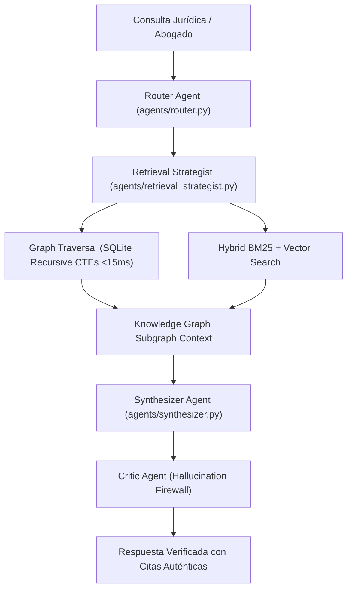

# Legal GraphRAG Engine

> Deterministic Knowledge Graph and GraphRAG Engine for Peruvian Jurisprudence and Statutes using SQLite Recursive Common Table Expressions (CTEs) and Multi-Agent Orchestration.

[](LICENSE)
[]()
[-emerald.svg)]()
[]()

---

## 🏛️ System Overview

Standard vector-only RAG pipelines suffer from severe context fragmentation when querying legal structures with deep hierarchical dependencies (e.g., articles citing previous laws, modified decrees, and binding precedents).

`legal-graph-rag` solves this by coupling relational graph traversal with multi-agent evaluation:

1. **Sub-15ms Graph Traversal via SQLite CTEs**:
   - Stores legal ontology nodes (Norma, Artículo, Inciso, Resolución, Precedente) and directed edges (CITA_A, MODIFICA, DEROGA, RECHAZA) in SQLite WAL mode.
   - Executes recursive Common Table Expressions (CTEs) directly in SQL, eliminating the high memory overhead of external graph databases like Neo4j while achieving sub-15ms P99 traversal times.

2. **Decoupled Multi-Agent Cognitive Architecture (`agents/`)**:
   - **`router.py`**: Categorizes user intent (interpretation, precedent check, normative conflict) and dispatches retrieval plans.
   - **`retrieval_strategist.py`**: Balances lexical BM25 retrieval, vector similarity, and relational graph expansion.
   - **`critic.py`**: Hallucination firewall that audits LLM synthesis against exact primary source citations before release.
   - **`synthesizer.py`**: Structured legal output formatter with traceable case-law anchors.



```text
┌────────────────────────────────────────────────────────┐
│              Consulta Jurídica / Abogado               │
└──────────────────────────┬─────────────────────────────┘
                           │
                           ▼
┌────────────────────────────────────────────────────────┐
│            Router Agent (agents/router.py)             │
└──────────────────────────┬─────────────────────────────┘
                           │
                           ▼
┌────────────────────────────────────────────────────────┐
│     Retrieval Strategist (agents/retrieval_strategist) │
└──────────────┬──────────────────────────┬──────────────┘
               │                          │
               ▼                          ▼
┌──────────────────────────────┐ ┌───────────────────────┐
│ Recursive SQLite CTEs (<15ms)│ │ Hybrid BM25 & Vectors │
└──────────────┬───────────────┘ └───────────┬───────────┘
               │                             │
               ▼                             ▼
┌────────────────────────────────────────────────────────┐
│ Knowledge Graph Subgraph + Normative Hierarchy Context │
└──────────────────────────┬─────────────────────────────┘
                           │
                           ▼
┌────────────────────────────────────────────────────────┐
│ Synthesizer Agent + Critic Hallucination Firewall      │
└────────────────────────────────────────────────────────┘
```

---

## 🚀 Quickstart

```bash
# 1. Setup environment
python3 -m venv .venv
source .venv/bin/activate
pip install -r requirements.txt 2>/dev/null || pip install fastapi uvicorn networkx pydantic httpx

# 2. Launch Graph API
python api.py
```

---

## 📄 License
MIT License. Open research for neurosymbolic legal informatics.
